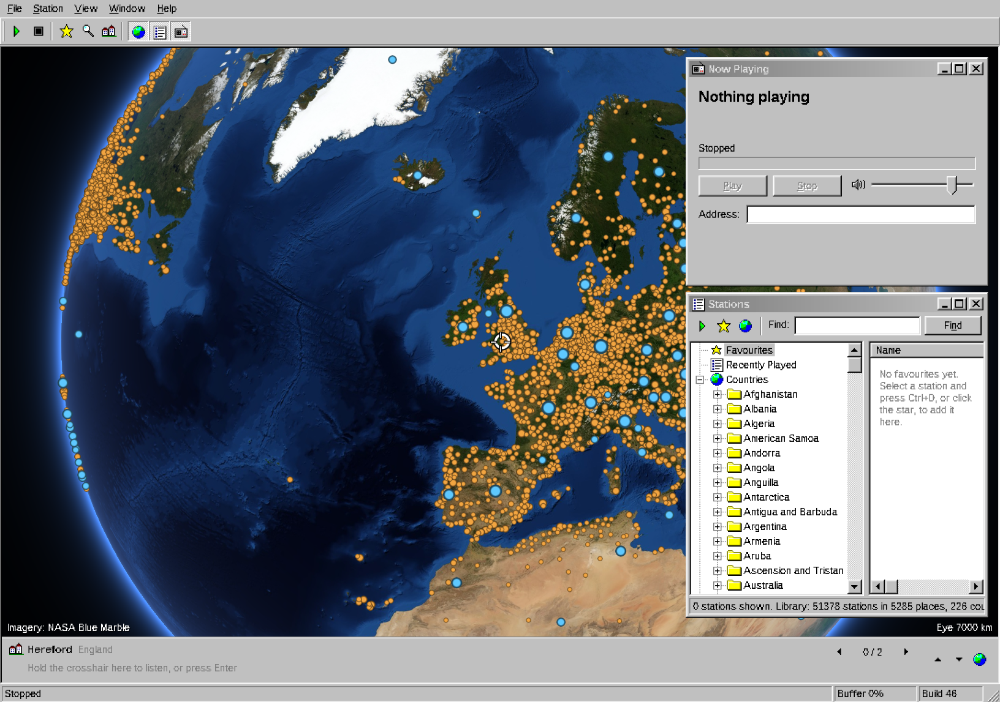

# Ensō Radio for Linux

*Formerly DX Garden (renamed 2026-11-25).*

A radio player and explorer in the spirit of spinning a globe and listening
to what's on air somewhere else. Turn the globe, hold the crosshair on a
place, and hear its stations.

Ensō Radio started on the PS Vita; the Vita app lives in its own repository,
[hiraethsystems/Enso-Radio-Vita](https://github.com/hiraethsystems/Enso-Radio-Vita).
This repository is the Linux desktop app. The two share a station-file
format and began from the same code, but are developed and released
separately.



**It comes with a station list, and the list is yours.** The AppImage
includes about 51,000 stations from a snapshot of
[Radio Browser](https://www.radio-browser.info), a community station
directory, which become your `stations.txt` the first time the app starts.
After that, stations come from your own `stations.txt`, M3U/PLS files you
drop in, or URLs you type in. The app can download a fresh list from Radio
Browser when you ask it to (File, Download Station List); it never does so
by itself.

**About the bundled list:** it was correct as of the date of the release it
shipped with (the date is at the top of the file). Radio stations move,
change address and close, and Radio Browser's entries are written by its
users, so some stations will stop working or be placed oddly over time.
Keeping the list up to date, and any changes you make to it, are your
responsibility. The app never overwrites your `stations.txt`; delete it
and restart the app to get the bundled list back, or build a fresh one
with File, Download Station List or the desktop script (see "Building a
station list" below).

## Status

**Beta (0.9.2).** Tested on Debian 13 with KDE Plasma 6; reports from
other distributions and desktops are welcome as GitHub issues, with the
log from `~/.local/share/ensoradio/`.

- The globe, with a dot for each place: hold the crosshair on one to
  listen. A station library by country, city and genre, with favourites,
  recently played and search.
- MP3, AAC and HE-AAC (v1 and v2), Ogg Vorbis, Opus and FLAC streams, and
  HLS streams (`.m3u8`, used by the BBC, Radio France and many others),
  unless they're encrypted. It works out the format from the stream
  itself, so a station that calls its AAC "MP3" still plays.
- Now Playing shows the song and the artist when the station sends them
  (as a stream title, or in the tags of Ogg, FLAC and HLS streams), and a
  Website link (also Station, Open Website) when the station has one: a
  `web:https://...` word in the station's Notes, or the address the stream
  itself announces.
- Works on KDE Plasma and GNOME, on Wayland and X11.

## Installing

Download the latest `ensoradio-<version>-x86_64.AppImage` from the
releases (0.9.2 and earlier are named `dxgarden-…`). It runs on
most distributions from 2024 on: it needs glibc 2.38 or later (Ubuntu
24.04+, Fedora 39+, Debian 13+, Arch, openSUSE Tumbleweed).

To try it, make it executable and start it:

```sh
chmod +x ensoradio-<version>-x86_64.AppImage
./ensoradio-<version>-x86_64.AppImage
```

To add it to your desktop's menu (KDE Plasma, GNOME and others), keep it
somewhere permanent under a fixed name and write a menu entry and icon for
it. Run this in the folder you downloaded it to:

```sh
mkdir -p ~/Applications ~/.local/share/applications ~/.local/share/icons/hicolor/128x128/apps
mv ensoradio-<version>-x86_64.AppImage ~/Applications/ensoradio.AppImage
chmod +x ~/Applications/ensoradio.AppImage
(cd /tmp && ~/Applications/ensoradio.AppImage --appimage-extract systems.hiraeth.ensoradio.png >/dev/null &&
  mv squashfs-root/systems.hiraeth.ensoradio.png ~/.local/share/icons/hicolor/128x128/apps/ &&
  rm -r squashfs-root)
cat > ~/.local/share/applications/systems.hiraeth.ensoradio.desktop <<EOF
[Desktop Entry]
Type=Application
Name=Ensō Radio
GenericName=Radio Explorer
Comment=Spin a globe and listen to live radio streams from your own station list
Exec="$HOME/Applications/ensoradio.AppImage"
Icon=systems.hiraeth.ensoradio
Terminal=false
Categories=AudioVideo;Audio;Player;
Keywords=radio;stream;internet radio;globe;
StartupWMClass=systems.hiraeth.ensoradio
EOF
```

Ensō Radio then shows up under Multimedia (on KDE, run `kbuildsycoca6` if it
doesn't appear straight away). To update, replace
`~/Applications/ensoradio.AppImage` with the new file. Your stations,
favourites and settings live in `~/.local/share/ensoradio/` and are kept.
If the system has no FUSE, start the AppImage with
`--appimage-extract-and-run`.

### Updating from DX Garden

The first start of Ensō Radio moves `~/.local/share/dxgarden/` to
`~/.local/share/ensoradio/`, so your stations, favourites, settings and
cache come along. The app ID changed too (`club.hiraeth.dxgarden` is now
`systems.hiraeth.ensoradio`), so if you made a menu entry for DX Garden,
remove the old one and make a new one as above:

```sh
rm -f ~/.local/share/applications/club.hiraeth.dxgarden.desktop \
      ~/.local/share/icons/hicolor/128x128/apps/club.hiraeth.dxgarden.png \
      ~/Applications/dxgarden.AppImage
```

An installed copy (`cmake --install`) leaves `bin/dxgarden` and
`share/club.hiraeth.dxgarden/` behind under its prefix; delete them by
hand.

## Downloading a fresh station list

File, Download Station List builds a new list from today's Radio Browser,
the same way the bundled list was made. Choose the formats (all of them,
HLS included, by default), and if you like some countries (two-letter
codes such as `GB,IE`), a tag, a lowest bitrate, how many stations at
most (the most popular first) and how far a station can be from a town
before it keeps its own position. Then:

1. The app asks Radio Browser for the stations, one page of 500 a second
   to go easy on its volunteer-run servers. The whole directory takes
   about a minute, or about three with stations without coordinates.
2. The first time, it downloads GeoNames' town list (`cities1000.zip`,
   11 MB) and region names (`admin1CodesASCII.txt`, 150 KB) and Natural
   Earth's country borders (3 MB), and keeps them in
   `~/.local/share/ensoradio/cache/` for next time. Tick "Download the town
   names, regions and borders again" to refresh them.
3. It writes `stations-new.txt` in the data folder and shows a summary.
   Nothing changes until you press **Replace My Station List**, which
   keeps your old list as `stations-backup-<date>.txt` and loads the new
   one. Favourites and recently played are kept (they're stream
   addresses).

"Stations without coordinates" (on by default) also keeps the stations
Radio Browser has no position for, about four in five of them. Each is
placed, in this order: at another stream of the same station (same name
and website); at the town or region given as its region (a region's
stations go to its capital); at a town or region named in its name or
tags; or, when nothing says where it is, in its country's
**Country-wide** place, a light blue dot at the middle of the country.
The Notes say which, and these positions are only as good as Radio
Browser's region field: a station placed by region is in the right
region, not necessarily the right town. UK stations that give only "UK"
are in United Kingdom, Country-wide (no nation can be told).

The new list replaces stations you added or edited in `stations.txt`
(they're still in the backup); stations in `import/` aren't touched.
Country labels follow where a station is: UK stations by nation
(England, Scotland, Wales, Northern Ireland), the Crown Dependencies by
their own names, Ukraine's territory (Crimea included) as Ukraine, and
Palestinian territory as Gaza or Occupied West Bank.

Without a window, `ensoradio --download-list [--codecs all] [--hls]
[--countries GB,IE] [--max N] [--without-coords] [--refresh]` does steps
1 to 3 and prints the summary (its defaults are MP3 only and 2,000
stations, as with the script).

## Looks

View, Look switches between the classic look and a flat one in your
desktop's colours (your KDE colour scheme, or GNOME's light or dark style).
On KDE Plasma it runs through XWayland by default (SDL's choice there); to
run it as a native Wayland app, start it with `SDL_VIDEO_DRIVER=wayland`.

## Your files

All in `~/.local/share/ensoradio/`, created on first run if missing.

- `stations.txt`: your stations, one per line:
  `Name | Stream URL | Country | City | Latitude | Longitude | Genre | Notes`.
  The file explains the format. In the Notes, `web:<address>` gives the
  station's website.
- `import/`: drop M3U, M3U8 or PLS files here. Their stations appear under
  "Unplaced" until you give them a place in the app.
- `favourites.txt`, `recent.txt`: managed by the app (URLs, one per line).
- `config.ini`: settings.
- `cache/`: GeoNames and Natural Earth files for Download Station List.
- `log-<version>-b<build>.txt`: log of the last run of that build, and
  `...-previous.txt` for the run before it.

## Versions

The release number is MAJOR.MINOR.PATCH (`linux/VERSION`), and the build
number for test builds (`linux/BUILD`) only goes up. The app, the log and
test AppImages show both, e.g. "0.9.2 (build 48)" and
`ensoradio-0.9.2-b48-x86_64.AppImage` (builds up to 47 were named `dxgarden-…`). Releases are tagged `linux-vX.Y.Z`
and their AppImage is named without the build number
(`tools/make_appimage.sh --release`). Linux 0.9.1 was released from the
Vita repository (then DX-Garden, now Enso-Radio-Vita), as `v0.9.1`.

## Building

### The AppImage

`tools/make_appimage.sh` builds `dist/ensoradio-<version>-b<build>-x86_64.AppImage`,
one file that runs on most Linux distributions from 2024 on. It needs the
libraries below built first:

```sh
tools/build_linux_deps.sh linux
tools/build_linux_deps.sh linux-static
python3 tools/make_earth.py --cache third_party/earth --out assets-build
tools/make_appimage.sh
```

`tools/make_appimage.sh --release` names it `ensoradio-<version>-x86_64.AppImage`
instead, for a release.

### From source

To build and install it for your user without an AppImage, on Debian 13
you need these packages:

```sh
sudo apt install cmake ninja-build meson curl libcurl4-openssl-dev libmpg123-dev \
  libfaad-dev libvorbis-dev libopusfile-dev libflac-dev zlib1g-dev \
  libfreetype-dev libharfbuzz-dev libfribidi-dev libx11-dev libxext-dev libxrandr-dev \
  libxcursor-dev libxi-dev libxss-dev libxfixes-dev libwayland-dev libxkbcommon-dev \
  wayland-protocols libdecor-0-dev libegl-dev libgl-dev libpipewire-0.3-dev libpulse-dev \
  libasound2-dev libdbus-1-dev libudev-dev
```

Then build SDL3, the globe's imagery (a one-off download of NASA's Blue
Marble, about 70 MB once built; needs Pillow) and the app, and install it
for your user:

```sh
tools/build_linux_deps.sh linux
python3 tools/make_earth.py --cache third_party/earth --out assets-build
cmake -S . -B build-linux -G Ninja && cmake --build build-linux
cmake --install build-linux --prefix ~/.local
```

The program's own files go in `~/.local/share/systems.hiraeth.ensoradio/`, so
reinstalling never touches your stations or favourites.

### Tests

`core/` (station files, playlists, streams, the station-list builder) has
unit tests that need only a C compiler and zlib:

```sh
cmake -S . -B build-test -DDXG_APP=OFF && cmake --build build-test && ./build-test/ensoradio_test
python3 -I tools/test_rb_to_stations.py
```

`tests/compare_listtool.sh` checks that the app's list builder
(`core/rb_build.c`) writes the same list as `tools/rb_to_stations.py`.

## Building a station list (optional)

`tools/rb_to_stations.py` (Python 3.8+, standard library only) downloads
stations from Radio Browser once and writes a `stations.txt`, the same way
Download Station List does. Radio Browser has no city field, so the script
fills it from a GeoNames cities file you download first
(https://download.geonames.org/export/dump/cities1000.zip), falling back
to Radio Browser's region (state or province).

With `--borders` and Natural Earth's country shapes
(`ne_50m_admin_0_countries.geojson`, public domain), it also checks that
each station is in its own country and fixes the usual mistakes: swapped
or sign-flipped coordinates, pins out at sea, a town given in the station's
name, and country codes picked wrongly from a list. Anything it changes is
explained in the station's Notes.

With `--without-coords` and GeoNames' region names (`--admin1
admin1CodesASCII.txt`) it also keeps stations without coordinates, placed
as described under "Downloading a fresh station list".

```sh
python3 tools/rb_to_stations.py --geonames cities1000.zip \
    --borders ne_50m_admin_0_countries.geojson --codecs all --hls \
    --max 10000 -o stations.txt
python3 tools/rb_to_stations.py --help   # countries, codecs, bitrate, tag, --check, --save-raw
```

The bundled list was made this way, with `--bundle <version>` for its
header (the exact command is in `NOTES.md`).

## Credits and licences

- Ensō Radio is licensed under the GNU GPL v3 (see `LICENSE`).
- Linked into the AppImage: SDL3 (zlib licence), libcurl (curl licence),
  Mbed TLS (Apache 2.0), mpg123 (LGPL 2.1), faad2 (GPL 2 or later),
  libogg, libvorbis, Opus, opusfile and libFLAC (BSD), FreeType (FreeType
  licence), HarfBuzz (MIT), FriBidi (LGPL 2.1) and zlib (zlib licence).
- Unicode tables made from the Unicode Character Database (Unicode
  licence).
- Fonts: Liberation Sans, and Noto Sans, Noto Sans Arabic, Hebrew, Thai,
  Georgian and Ethiopic, and a subset of Noto Sans CJK SC made by
  `tools/make_fonts.py`; all SIL Open Font License 1.1
  (`assets/fonts/OFL.txt`, `assets/fonts/OFL-Liberation.txt`).
- Globe imagery from NASA Blue Marble: Next Generation (Reto Stöckli, NASA
  Earth Observatory; public domain).
- The bundled station list (`assets/stations/linux/stations.txt`), lists
  made with `tools/rb_to_stations.py` and lists the app downloads come
  from Radio Browser (radio-browser.info), whose API documentation says it
  may be used in free and non-free software and its data mirrored. Town
  and region names come from GeoNames (geonames.org), licensed CC BY 4.0.
  Positions are checked against Natural Earth country shapes (public
  domain). The app downloads GeoNames' `cities1000.zip` and
  `admin1CodesASCII.txt` from download.geonames.org and Natural Earth's
  `ne_50m_admin_0_countries.geojson` (v5.1.2) from the natural-earth-vector
  repository on GitHub, only when you ask it to.
